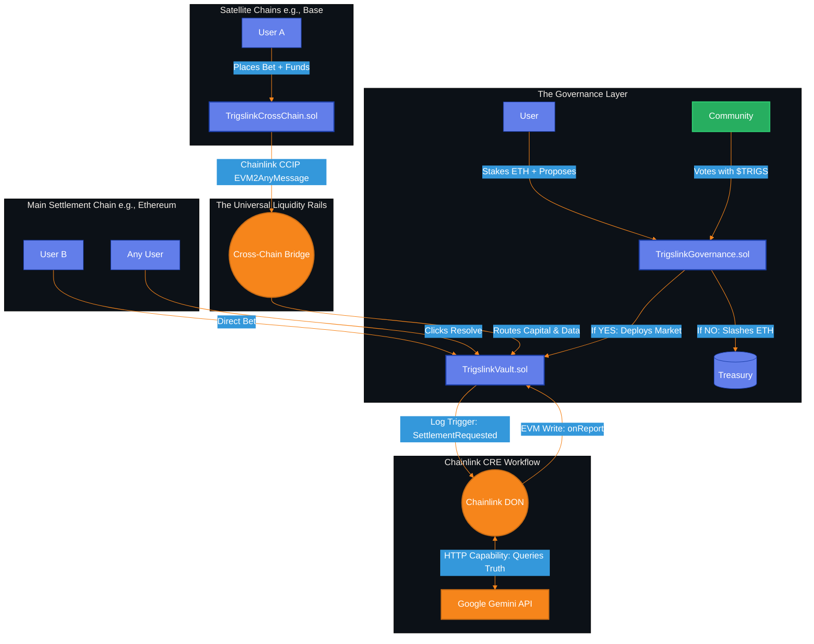
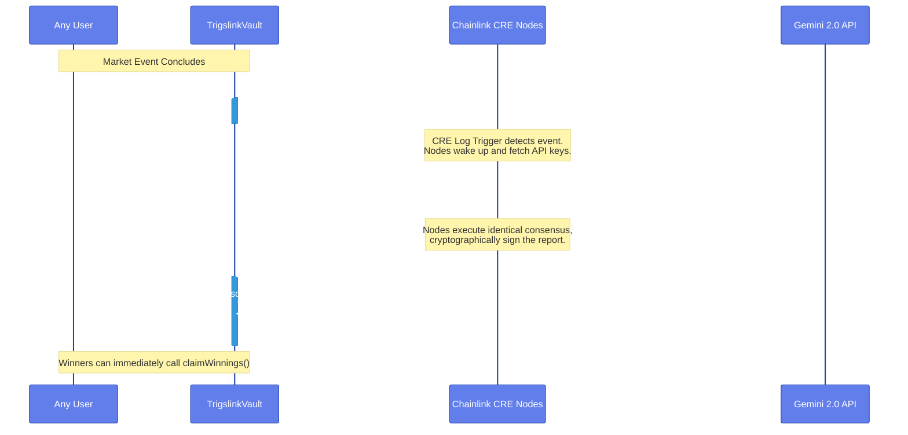

# Trigslink SDK: Smart Contract Infrastructure

This repository contains the foundational smart contracts powering the Trigslink SDK.

Trigslink is a decentralized infrastructure protocol designed to eliminate the "Zombie Period" of capital lockup in prediction markets. By replacing human-driven dispute windows with a deterministic, machine-verified truth engine, these contracts execute ~15-second settlement finality directly on-chain.

With the introduction of the **Trigslink Governance Engine**, the protocol now supports permissionless, community-curated market creation backed by economic staking and token-weighted voting, ensuring only high-quality, AI-resolvable markets reach the main execution vault.

Furthermore, this contract suite implements the protocol's **Universal Liquidity Rails (ULR)** via Chainlink CCIP, providing the execution logic required to unify fragmented cross-chain capital into a single global truth pool.

---

## System Architecture Overview

The Trigslink ecosystem operates on a dual-layer architecture: **Community Consensus** for market creation, and the **Chainlink Runtime Environment (CRE)** for autonomous settlement. The system is built on four core smart contract pillars and one off-chain workflow:

1. **The Governance Filter (`TrigslinkGovernance.sol` & `TrigsToken.sol`)**: The entry point. Users stake native gas (ETH) to propose markets. The community votes using `$TRIGS` tokens. If passed, the market is autonomously deployed to the Vault. If rejected, the proposer's stake is slashed.
2. **The Financial Engine (`TrigslinkVault.sol`)**: The master hub. It holds the unified liquidity, tracks user positions, emits the wake-up events for the Chainlink nodes, and receives the final AI outcome directly via the `IReceiver` interface.
3. **The Universal Liquidity Bridge (`TrigslinkCrossChain.sol`)**: Utilizes Chainlink CCIP to capture bets from satellite chains (e.g., Base, Arbitrum) and route the capital securely to the main Vault.
4. **The Autonomous Brain (Off-Chain CRE Workflow)**: A decentralized TypeScript application hosted on the Chainlink Decentralized Oracle Network (DON). It listens for market settlement requests, queries Google Gemini 2.0, reaches consensus, and pushes the truth back on-chain.

### High-Level Capital & Data Flow



---

## Smart Contract Deep Dives

### 1. `TrigslinkGovernance.sol` (The Curation Engine)

Prevents spam and ensures market quality before capital is ever at risk.

* **`proposeMarket(...)`**: Requires a strict native gas stake (e.g., 0.001 ETH). Locks the market question and preferred `dataSource` for the AI.
* **`vote(...)`**: Reads the user's `$TRIGS` balance to calculate voting weight (1 Token = 1 Vote).
* **`executeProposal(...)`**: The consensus trigger. If YES votes win, it automatically calls `createMarket` on the Vault and refunds the creator's ETH. If NO votes win, the ETH is slashed and sent to the protocol treasury to deter spam.

### 2. `TrigsToken.sol` ($TRIGS)

The native ERC-20 utility token powering the governance voting weights. Includes a `mintTestTokens()` faucet for testnet environments to allow easy community onboarding.

### 3. `TrigslinkVault.sol` (The Hub)

This is the master settlement contract. It operates deterministically and has **no human owner**.

* **`createMarket(...)`**: Called strictly by the Governance contract. Initializes the market, question, and `dataSource`.
* **`placeBet(...)`**: Accepts incoming capital with strict "Ghost Market" protection, rejecting any bets on non-existent markets.
* **`requestSettlement(...)`**: Emits the `SettlementRequested` event—the critical Log Trigger that wakes up the off-chain AI workflow.
* **`onReport(bytes metadata, bytes report)`**: The settlement lock. **Only** the official Chainlink Keystone Forwarder can call this function to inject the AI's cryptographic consensus into the blockchain.
* **`claimWinnings(...)`**: Unlocks capital the second the market is resolved using proportional payout math `(userBet * totalPool) / winningPool`.

### 4. `TrigslinkCrossChain.sol` (The Bridge / ULR)

Solves liquidity fragmentation. Deployed on satellite networks, it acts as a localized proxy. It pulls user tokens, encodes their chosen outcome, pays the CCIP relayer fees, and securely transmits the financial payload across the bridge directly into the master `TrigslinkVault`.

---

## The 15-Second Resolution Sequence

By leveraging the Chainlink CRE architecture, Trigslink collapses multi-day dispute windows into a single block-cycle. Here is the exact lifecycle of a market resolution:



---

## Live Deployments (Sepolia Testnet)

The core infrastructure is currently live and verified on the Ethereum Sepolia Testnet.

* **$TRIGS Token:** [`0xc463bB636C67642870e2e82ebAdbd29e2C10eAFa`](https://sepolia.etherscan.io/address/0xc463bB636C67642870e2e82ebAdbd29e2C10eAFa)
* **Trigslink Vault:** [`0xaB9612273273Ca9AA61C35125E99C840651AA7E9`](https://sepolia.etherscan.io/address/0xaB9612273273Ca9AA61C35125E99C840651AA7E9)
* **Trigslink Governance:** [`0x7f344B5b55eD8d386462F8Cf9BD739c8c7ac87db`](https://sepolia.etherscan.io/address/0x7f344B5b55eD8d386462F8Cf9BD739c8c7ac87db)

---

## Local Development & Testing

Trigslink relies on strict access control and event emission. To test the local ecosystem:

1. **Install Dependencies:**

```bash
npm install
npm install @chainlink/contracts-ccip @openzeppelin/contracts
```

2. **Run the Test Suite:**
The test suite utilizes `ethers` to simulate the Chainlink Keystone Forwarder, proving that only the DON can push results into `onReport`, verifying the Ghost Market patch, and executing full Governance lifecycle tests (Propose -> Vote -> Execute -> Settle).

```bash
npx hardhat test
```

---

## Security & Risk Isolation

* **Economic Spam Resistance:** Requiring a native ETH stake to propose markets forces bad actors to pay for protocol abuse. The slashing mechanism redirects this capital to the treasury.
* **Ghost Market Prevention:** The `placeBet` function enforces a strict verification check (`require(bytes(markets[_marketId].marketId).length != 0)`). This guarantees malicious actors cannot open phantom pools that would cause the AI verification to crash due to a missing query string.
* **Strict Access Control:** The `onReport` function is hard-coded to `require(msg.sender == chainlinkForwarder)`, completely stripping human administrators or multi-sigs of settlement authority.
* **Reentrancy Protection:** All critical financial functions (proposals, executions, claiming winnings) utilize OpenZeppelin's `nonReentrant` modifier. State changes occur *strictly before* external ETH transfers.

---

## License

This project is licensed under the MIT License.