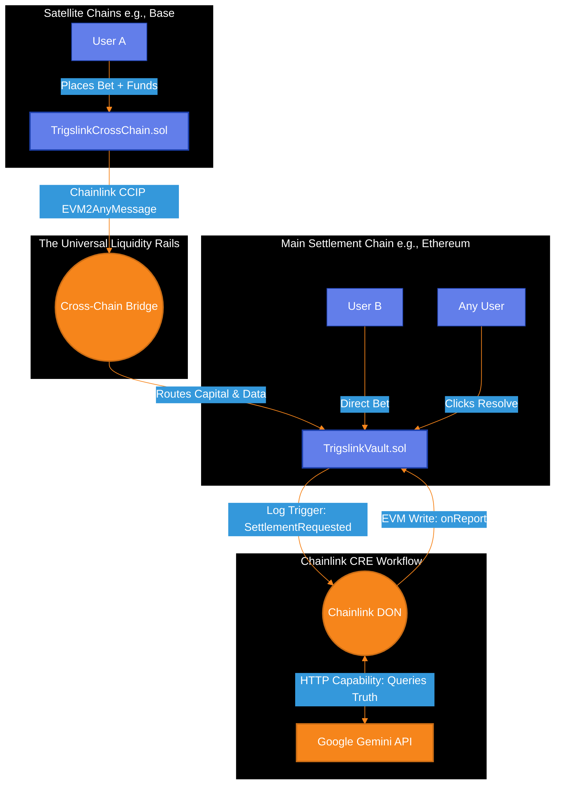
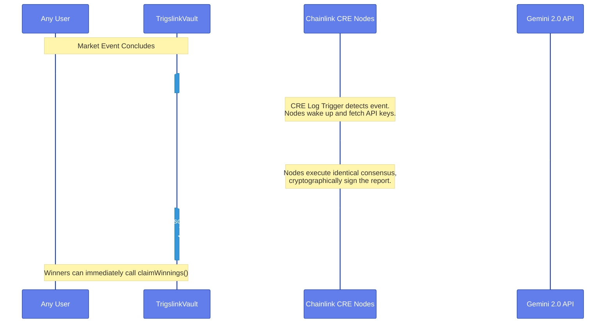

# Trigslink SDK: Smart Contract Infrastructure

This repository contains the foundational smart contracts powering the Trigslink SDK.

Trigslink is a decentralized infrastructure protocol designed to eliminate the "Zombie Period" of capital lockup in prediction markets. By replacing human-driven dispute windows with a deterministic, machine-verified truth engine, these contracts execute ~15-second settlement finality directly on-chain.

Furthermore, this contract suite implements the protocol's **Universal Liquidity Rails (ULR)** via Chainlink CCIP, providing the execution logic required to unify fragmented cross-chain capital into a single global truth pool.

---

## System Architecture Overview

The Trigslink ecosystem has been upgraded to utilize the **Chainlink Runtime Environment (CRE)** , shifting the heavy AI verification logic entirely off-chain. The system is built on two core smart contract pillars and one off-chain workflow:

1. **The Financial Engine (`TrigslinkVault.sol`)**: The master hub. It holds the unified liquidity, tracks user positions, emits the wake-up events for the Chainlink nodes, and receives the final AI outcome directly via the `IReceiver` interface.
2. **The Universal Liquidity Bridge (`TrigslinkCrossChain.sol`)**: Utilizes Chainlink CCIP to capture bets from satellite chains (e.g., Base, Arbitrum) and route the capital securely to the main Vault.
3. **The Autonomous Brain (Off-Chain CRE Workflow)**: A decentralized TypeScript application hosted on the Chainlink Decentralized Oracle Network (DON). It listens for market settlement requests, queries Google Gemini 2.0, reaches consensus, and pushes the truth back on-chain.

### High-Level Capital & Data Flow



---

## Smart Contract Deep Dives

### 1. `TrigslinkVault.sol` (The Hub)

This is the master settlement contract. It operates deterministically and has **no human owner**. It strictly enforces market creation to ensure the AI always has context.

- **`createMarket(string _marketId, string _question)`**: Initializes the market and locks in the exact question the AI will answer.
- **`placeBet(string _marketId, uint8 _outcome)`**: Accepts incoming capital. It features strict "Ghost Market" protection, rejecting any bets on non-existent markets.
- **`requestSettlement(string _marketId)`**: Anyone can call this when a market concludes. It emits the `SettlementRequested` event—the critical Log Trigger that wakes up the off-chain AI workflow.
- **`onReport(bytes metadata, bytes report)`**: The settlement lock. This function implements Chainlink's `IReceiver` interface. **Only** the official Chainlink Keystone Forwarder can successfully call this function to inject the AI's cryptographic consensus into the blockchain.
- **`claimWinnings(string _marketId)`**: Unlocks capital the second the market is resolved. Uses proportional payout math `(userBet * totalPool) / winningPool` to ensure fair distribution.

### 2. `TrigslinkCrossChain.sol` (The Bridge / ULR)

This contract solves liquidity fragmentation. Deployed on satellite networks, it acts as a localized proxy for the main Vault.

- **`placeCrossChainBet(...)`**: A user inputs their bet on a satellite chain. This contract pulls their tokens, encodes their chosen outcome and address, and packages it into a `Client.EVM2AnyMessage`.
- **CCIP Routing**: It pays the Chainlink relayer fees (in LINK or native gas) and securely transmits both the financial payload and the user's data across the bridge, directly depositing it into the master `TrigslinkVault`.

---

## The 15-Second Resolution Sequence

By leveraging the Chainlink CRE architecture, Trigslink collapses multi-day dispute windows into a single block-cycle. Here is the exact lifecycle of a market resolution:



---

## Local Development & Testing

Trigslink relies on strict access control and event emission. To test the local ecosystem:

1. **Install Dependencies:**

```bash
npm install
npm install @chainlink/contracts-ccip @openzeppelin/contracts
```

2. **Run the Vault Test Suite:**
   The test suite utilizes `ethers` to simulate the Chainlink Keystone Forwarder, proving that only the DON can push results into `onReport` and verifying the Ghost Market patch.

```bash
npx hardhat test
```

---

## Security & Risk Isolation

- **Ghost Market Prevention:** The `placeBet` function enforces a strict verification check (`require(bytes(markets[_marketId].marketId).length != 0)`). This guarantees malicious actors cannot open phantom pools that would cause the AI verification to crash due to a missing query string.
- **Heuristic Inference Protection:** Resolution logic is decoupled from token-weighted voting. The "Truth" is executed via the Chainlink DON and Gemini AI, eliminating traditional bribery vectors.
- **Strict Access Control:** The `onReport` function is hard-coded to `require(msg.sender == chainlinkForwarder)`, completely stripping human administrators or multi-sigs of settlement authority.
- **Reentrancy Protection:** State changes in `claimWinnings` (zeroing out user balances) occur *strictly before* the external ETH transfer.

---

## License

This project is licensed under the MIT License.
