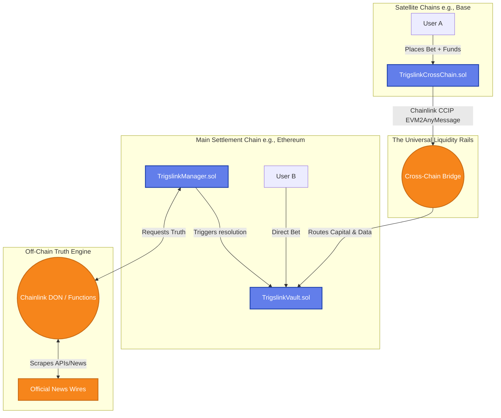
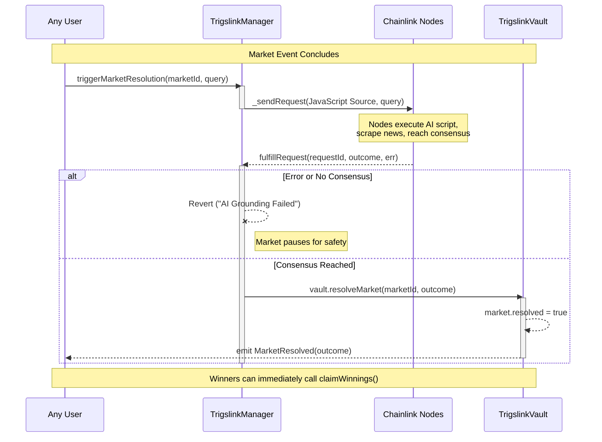

# 🔗 Trigslink SDK: Smart Contract Infrastructure

This repository contains the foundational smart contracts powering the Trigslink SDK. 

Trigslink is a decentralized infrastructure protocol designed to eliminate the "Zombie Period" of capital lockup in prediction markets. By replacing human-driven dispute windows with a deterministic, machine-verified truth engine, these contracts execute 15-second settlement finality directly on-chain.

Furthermore, this contract suite implements the protocol's **Universal Liquidity Rails (ULR)** via Chainlink CCIP, providing the execution logic required to unify fragmented cross-chain capital into a single global truth pool.

---

## System Architecture Overview

The Trigslink ecosystem is built on three core smart contract pillars:

1. **The Financial Engine (`TrigslinkVault.sol`)**: Holds the unified liquidity, tracks user positions, and calculates proportional payouts.
2. **The Autonomous Brain (`TrigslinkManager.sol`)**: Utilizes Chainlink Functions to ping official news wires/APIs, verify off-chain truth, and trigger autonomous settlement.
3. **The Universal Liquidity Bridge (`TrigslinkCrossChain.sol`)**: Utilizes Chainlink CCIP to capture bets from satellite chains (e.g., Base, Arbitrum) and route the capital to the main Vault.

### High-Level Capital & Data Flow



---

## Smart Contract Deep Dives

### 1. `TrigslinkVault.sol` (The Hub)

This is the master settlement contract. It operates deterministically and has **no human owner**.

- **`placeBet(string _marketId, uint8 _outcome)`**: Accepts incoming capital, tracking exact weights on Outcome 1 (YES) and Outcome 2 (NO) to enable dynamic odds calculation.
- **`resolveMarket(string _marketId, uint8 _outcome)`**: The settlement lock. This function enforces strict access control—**only** the `TrigslinkManager` can call it. No human, multisig, or DAO can manually alter a market's outcome.
- **`claimWinnings(string _marketId)`**: Unlocks capital the second the market is resolved. Uses proportional payout math `(userBet * totalPool) / winningPool` to ensure fair distribution of the losing side's liquidity to the winners.

### 2. `TrigslinkManager.sol` (The Brain)

This contract replaces the legacy "Optimistic Oracle" dispute period. It acts as a Decentralized API (dAPI) client using Chainlink Functions.

- **`triggerMarketResolution(...)`**: Initiates the AI verification process. It packages the market query (e.g., "Did the AI Bill pass the Senate?") and sends it to the Chainlink Decentralized Oracle Network (DON).
- **`fulfillRequest(...)`**: The callback function. Within ~15 seconds, the DON reaches a consensus on the truth and returns the data here. If consensus is reached, it autonomously calls `resolveMarket` on the Vault. If nodes disagree, it reverts, triggering the protocol's **Extended Verification Mode** to protect user funds from data glitches.

### 3. `TrigslinkCrossChain.sol` (The Bridge / ULR)

This contract solves liquidity fragmentation. Deployed on satellite networks, it acts as a localized proxy for the main Vault.

- **`placeCrossChainBet(...)`**: A user inputs their bet on a satellite chain. This contract pulls their tokens, encodes their chosen outcome and address, and packages it into a `Client.EVM2AnyMessage`.
- **CCIP Routing**: It pays the Chainlink relayer fees (in LINK or native gas) and securely transmits both the financial payload and the user's data across the bridge, directly depositing it into the master `TrigslinkVault`.

---

## The 15-Second Resolution Sequence

The core innovation of Trigslink is collapsing multi-day dispute windows into a single block-cycle. Here is the exact lifecycle of a market resolution:



---

## Local Development & Testing

Trigslink relies on complex cross-contract integration. To test the local ecosystem:

1. **Install Dependencies:**
```bash
npm install
npm install @chainlink/contracts @chainlink/contracts-ccip
```

2. **Run the Integration Test Suite:**
Because the Vault and Manager require each other's addresses to deploy, the test suite utilizes `ethers.getCreateAddress` nonce-prediction to perfectly wire the ecosystem together locally, combined with a `MockFunctionsRouter` to simulate the Chainlink network.
```bash
npx hardhat test
```

---

## Security & Risk Isolation

- **Reentrancy Protection:** State changes in `claimWinnings` (zeroing out user balances) occur *strictly before* the external ETH transfer.
- **Heuristic Inference Protection:** Resolution logic is hard-coded into the Chainlink DON deployment script. The "Truth" is decoupled from token-weighted voting, eliminating bribery vectors.
- **Cross-Chain Safety:** The CCIP implementation uses a "lock-and-mint" security model. Funds locked on the satellite chain are only minted on the main chain once the CCIP message is finalized by the Risk Management Network.

---

## License

This project is licensed under the MIT License.