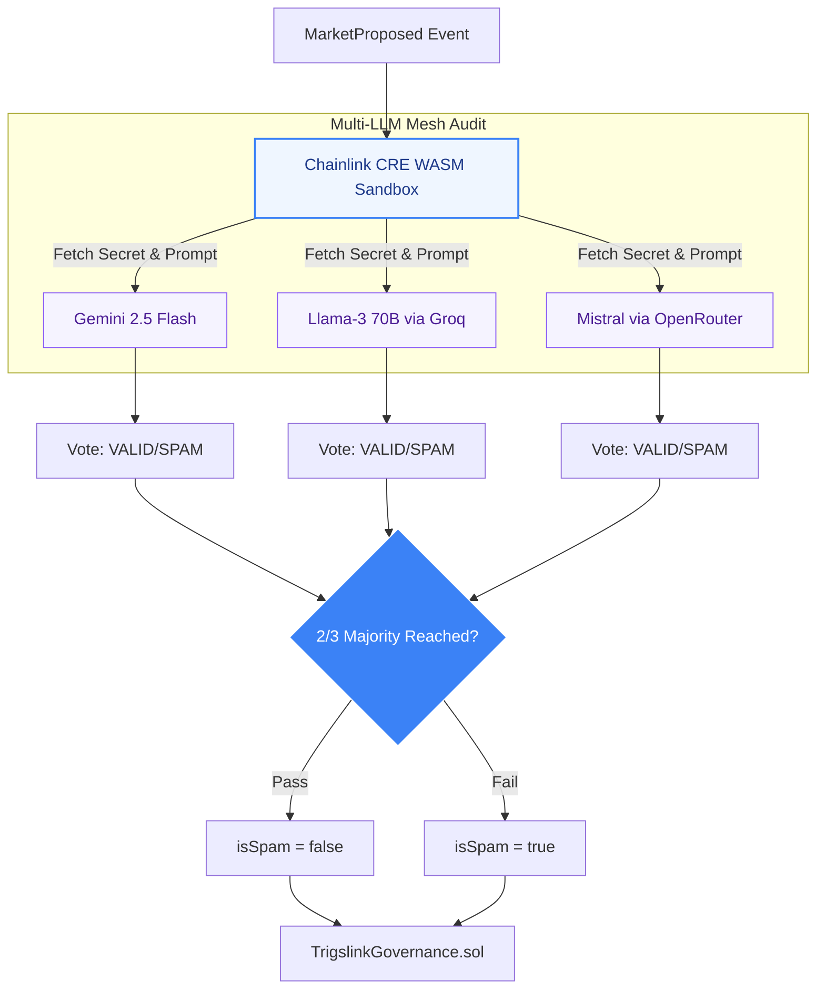
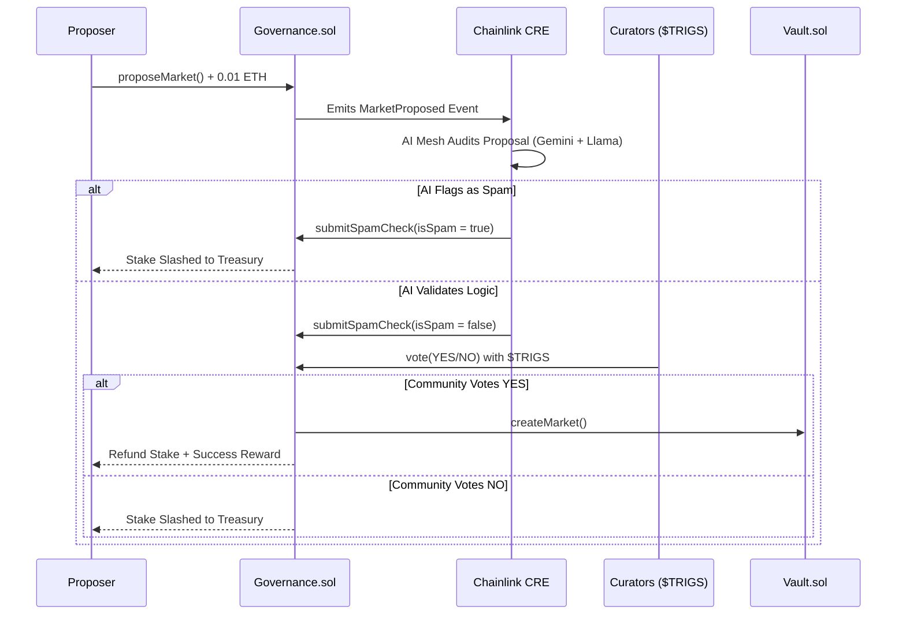

# Trigslink: AI-Augmented Decentralized Prediction Markets

**Live Application:** **[app.trigs.link](https://app.trigs.link)**
**Frontend Repository:** **[github.com/Trigs-link/trigslink-frontend](https://github.com/Trigs-link/trigslink-frontend)**

Trigslink is a decentralized prediction market protocol powered by Chainlink's new Custom Runtime Environment (CRE) and a decentralized mesh of Large Language Models (LLMs).

Whatever the real-world outcome is, Trigslink uses objective, verifiable AI consensus to curate markets, prevent spam, and resolve bets without relying on subjective human dispute periods or centralized oracles.

## Table of Contents

* [Overview](#overview)
* [The AI Mesh (Gatekeeper & Truth Engine)](#the-ai-mesh-gatekeeper--truth-engine)
* [Contracts / Architecture](#contracts--architecture)
* [TrigslinkGovernance.sol](#trigslinkgovernancesol)
* [TrigslinkVault.sol](#trigslinkvaultsol)
* [TrigsToken.sol](#trigstokensol)
* [System Actors](#system-actors)
* [Chainlink Integrations](#chainlink-integrations)
* [Custom Runtime Environment (CRE)](#custom-runtime-environment-cre)
* [CCIP (Future Roadmap)](#ccip-future-roadmap)
* [Transaction Flows](#transaction-flows)
* [Market Proposal & Curation](#market-proposal--curation)
* [Betting & Settlement](#betting--settlement)
* [Testnet Deployments](#testnet-deployments)
* [Challenges I Ran Into](#challenges-i-ran-into)
* [Future Developments](#future-developments)

---

## Overview

**Problem Statement:** "I want to trade on the outcome of future events, but existing prediction markets are flooded with spam proposals, ambiguous rules, and take days or weeks to resolve via human voting disputes."

**Solution:** Trigslink abstracts ALL of that away. By layering the [Chainlink Custom Runtime Environment (CRE)](https://docs.chain.link/) over our smart contracts, we automate both the **curation** and **resolution** of markets using a decentralized mesh of LLMs.

Users stake ETH to propose markets. The AI Mesh immediately audits the proposal for logical consistency and verifiable data sources. If it passes, the community votes it in. Once the event concludes, the CRE scrapes the live internet, queries the LLM mesh, and resolves the market on-chain instantly.

---

## The AI Mesh (Gatekeeper & Truth Engine)

Trigslink does not rely on a single point of failure for its intelligence. We utilize a **Multi-Model Consensus Mesh** operating inside the Chainlink CRE sandbox.

* **Gemini 2.5 Flash:** Acts as the lead logic engine, checking if the question is "future-facing" and fetching live data to resolve outcomes.
* **Llama-3 70B (via Groq):** Acts as the high-speed timekeeper and cross-referencer.
* **Mistral (via OpenRouter):** Acts as the objectivity auditor to ensure proposal rules are not biased.

For a market to pass curation, or for an outcome to be resolved, Trigslink requires a strict **2/3 Majority Consensus** from these models.

---

## Contracts / Architecture

The Trigslink system consists of a deeply integrated network of smart contracts deployed on the Sepolia Testnet, interacting continuously with off-chain Chainlink infrastructure.

```mermaid
graph LR
    User((User)) -->|Stake ETH & Propose| Gov[TrigslinkGovernance.sol]
    User -->|Trade & Claim| Vault[TrigslinkVault.sol]
    
    Gov -->|MarketProposed Event| CRE
    Vault -->|SettlementRequested Event| CRE

    subgraph "Chainlink CRE (Off-Chain WASM)"
        CRE{CRE Sandbox}
        Mesh[AI Consensus Mesh]
        CRE <-->|HTTP / API| Mesh
    end

    Mesh -.->|Validates / Resolves| CRE
    CRE -->|submitSpamCheck()| Gov
    CRE -->|onReport()| Vault
    
    style User fill:#3b82f6,stroke:#1d4ed8,color:#fff
    style Gov fill:#f1f5f9,stroke:#64748b,stroke-width:2px,color:#1e293b
    style Vault fill:#f1f5f9,stroke:#64748b,stroke-width:2px,color:#1e293b
    style CRE fill:#eff6ff,stroke:#3b82f6,stroke-width:3px,color:#1e3a8a
    style Mesh fill:#f5f3ff,stroke:#8b5cf6,stroke-width:2px,color:#4c1d95
```

### TrigslinkGovernance.sol

The `TrigslinkGovernance` contract is the curation hub. It tracks system-wide state for new proposals before they are allowed into the trading vault.

* `proposeMarket()`: Users must stake a `proposalStakeRequired` (in ETH) to suggest a market. This deters bad actors.
* `submitSpamCheck()`: A restricted endpoint exclusively called by the CRE Gatekeeper node to write the AI's spam verdict (`isSpam`) on-chain.
* `vote()`: Token holders use `$TRIGS` to vote YES or NO on the proposal.
* `executeProposal()`: If the market clears the AI check and community vote, it is pushed to the Vault. The proposer is refunded their stake *plus* a `successfulMarketReward`. If it is flagged as spam or voted down, the proposer's stake is slashed to the `treasury`.

### TrigslinkVault.sol

The `TrigslinkVault` manages the liquidity, betting, and resolution of live prediction markets.

* `createMarket()`: Restricted to the Governance contract. Initializes the pools.
* `placeBet()`: Allows users to bet ETH on Outcome 1 (Yes) or Outcome 2 (No) before the `endTime`.
* `requestSettlement()`: A public permissionless function that emits the `SettlementRequested` event, waking up the CRE Truth Engine once the market `endTime` has passed.
* `onReport()`: The Chainlink DON delivers the final, AI-verified outcome here, officially resolving the market.
* `claimWinnings()`: Calculates proportional payouts for the winners based on the opposing pool's liquidity.

### TrigsToken.sol

An ERC-20 token (`$TRIGS`) that dictates voting weight in the Governance contract. A public `mintTestTokens()` function is available for hackathon testers to freely participate in market curation.

---

## System Actors

1. **Market Proposers:** Stake ETH to suggest new markets, providing a question, timeframe, and verifiable data source URL.
2. **Curators (Token Holders):** Hold `$TRIGS` and vote on the validity of proposed markets.
3. **Bettors:** Deposit ETH into the Vault predicting specific outcomes.
4. **The Gatekeeper (Chainlink CRE Phase 1):** Automates spam detection to protect Curators from wasting time on junk markets.
5. **The Truth Engine (Chainlink CRE Phase 2):** Automates the final resolution of the market, retrieving real-world data to determine the winner.

---

## Chainlink Integrations

Trigslink leverages the bleeding edge of Chainlink's decentralized infrastructure to bridge on-chain markets with off-chain computation and data.

### Custom Runtime Environment (CRE)

Trigslink utilizes the **Chainlink CRE (v1.3.0 WASM Sandbox)** as the core engine, completely replacing legacy Automation and Functions patterns. The CRE allows us to write complex, long-running TypeScript workflows that execute natively within a secure WebAssembly environment.

* **Log Triggers:** The CRE uses `evmClient.logTrigger` to listen natively to `MarketProposed` and `SettlementRequested` events.
* **Decentralized Secrets:** We use `runtime.getSecret()` to securely manage API keys for Gemini, Groq, and OpenRouter across the DON.
* **HTTP Requests:** The CRE `HTTPClient` allows us to proxy requests through `r.jina.ai` to scrape live webpage content (the market's `dataSource`) and feed it directly into the LLMs for contextual resolution.



### CCIP (Future Roadmap)

We have drafted `TrigslinkCrossChain.sol` to utilize [Chainlink CCIP (Cross-Chain Interoperability Protocol)](https://docs.chain.link/ccip) for unified cross-chain liquidity. In the future, users will be able to place bets from Base, Arbitrum, or Optimism, seamlessly routing their stablecoins and bet data to the parent Vault on Ethereum.

---

## Transaction Flows

Transaction flows differ based on the lifecycle stage of the prediction market.

### Market Proposal & Curation



### Betting & Settlement

1. **Betting:** Users call `placeBet(marketId, outcome)` with ETH.
2. **Market Ends:** The `endTime` timestamp passes. Betting is locked.
3. **Trigger Settlement:** Anyone calls `requestSettlement()`.
4. **Truth Engine Analysis:** The CRE catches the log, scrapes the web data source, and asks the AI Mesh to resolve the outcome based *only* on the provided evidence.
5. **Resolution:** The Chainlink DON calls `Vault.onReport()` with the final winning outcome.
6. **Payout:** Winning users call `claimWinnings()` to withdraw their ETH.

---

## Testnet Deployments

Trigslink is deployed on the **Ethereum Sepolia Testnet**. We iterated through several versions; below are the V3 production contracts.

* **TrigslinkGovernance V3:** [`0xA3c6E2b06B3c511d52e7682Ba0Aec234F2BA692a`](https://sepolia.etherscan.io/address/0xA3c6E2b06B3c511d52e7682Ba0Aec234F2BA692a)
* **TrigslinkVault V3:** [`0xb989aaB780ae15E3820f8d97aE84D1bBB91914D2`](https://sepolia.etherscan.io/address/0xb989aaB780ae15E3820f8d97aE84D1bBB91914D2)
* **TrigsToken ($TRIGS):** [`0xc463bB636C67642870e2e82ebAdbd29e2C10eAFa`](https://sepolia.etherscan.io/address/0xc463bB636C67642870e2e82ebAdbd29e2C10eAFa)

---

## Challenges I Ran Into

Building an autonomous AI oracle required navigating significant technical hurdles, particularly with early-access infrastructure.

### CRE v1.3.0 WASM Memory Traps

During the integration of the Chainlink CRE simulator, I repeatedly encountered a critical `wasm trap: unreachable instruction executed` error. This "Blue Screen of Death" happened during the subscription phase when the WASM host tried to map EVM event filters.

**Solution:** Standard JavaScript libraries often handle `0x` prefixes gracefully, but the underlying Go-to-WASM converter in CRE v1.3.0 requires raw hex for the `hexToBase64` bridge. Passing `0x` created an invalid byte-length, causing memory misalignment. I engineered a `toB64` sanitization helper (`hexToBase64(hex.replace(/^0x/, ""))`) to strip prefixes, which stabilized the entire event-listener pipeline.

### LLM Hallucinations & Determinism

Relying on a single AI model (like Gemini) to resolve financial markets is inherently risky due to hallucinations and non-deterministic outputs.

**Solution:** I built the "Consensus Aggregation Mesh." Instead of one prompt, the CRE workflow simultaneously queries Gemini 2.5 Flash, Llama-3 70B (via Groq), and Mistral (via OpenRouter). The workflow requires a strict `validVotes >= 2` condition. This multi-model approach effectively filters out individual model hallucinations, creating a highly deterministic and objective oracle.

### Secure Web Scraping inside a Sandbox

The AI needed to read live webpages to resolve markets, but standard web-scraping libraries (like Puppeteer) cannot run inside the lightweight CRE WASM sandbox.

**Solution:** I utilized the `HTTPClient` to proxy URLs through `r.jina.ai`. This converted complex HTML pages into clean, LLM-readable markdown on the fly, allowing the AI to ingest thousands of words of real-time web context with a single, lightweight HTTP GET request.

---

## Future Developments

* **CCIP Cross-Chain Betting:** Fully integrating `TrigslinkCrossChain.sol` to allow liquidity deposits from Layer-2s (Arbitrum, Base, Optimism) directly into the Sepolia parent vault.
* **Automated Market Making (AMM):** Transitioning from a parimutuel pool model to an AMM (like a CPMM) to allow users to trade shares dynamically before the market resolves.
* **Yield-Bearing Deposits:** Routing the ETH locked in the Vault into Aave or Compound to generate yield for bettors while they wait for the market to resolve.
* **CRE Workflow Optimization:** Leveraging advanced payload compression for the `onReport()` callback to reduce gas overhead when the AI submits its final verdict.