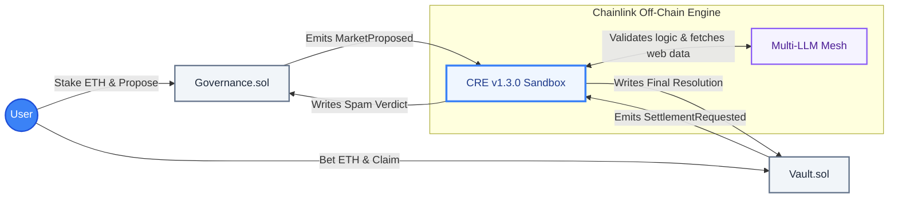
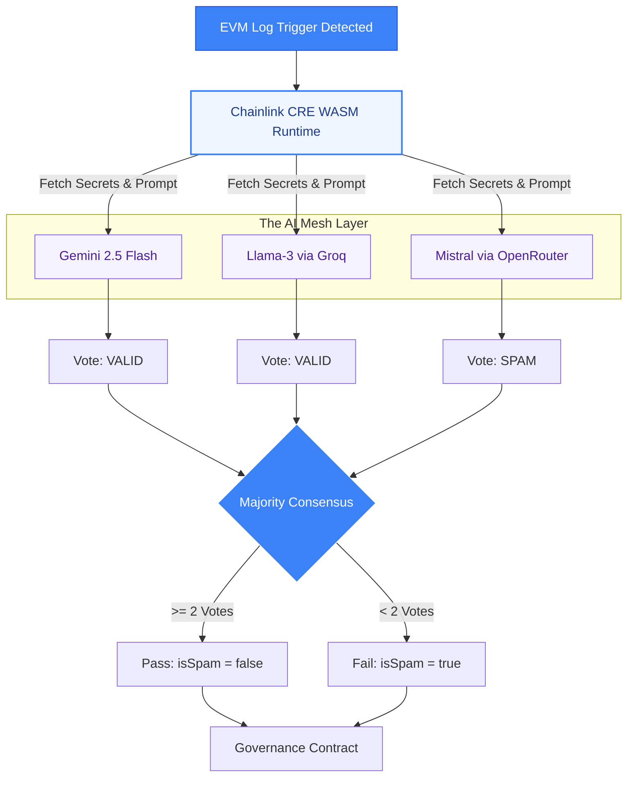
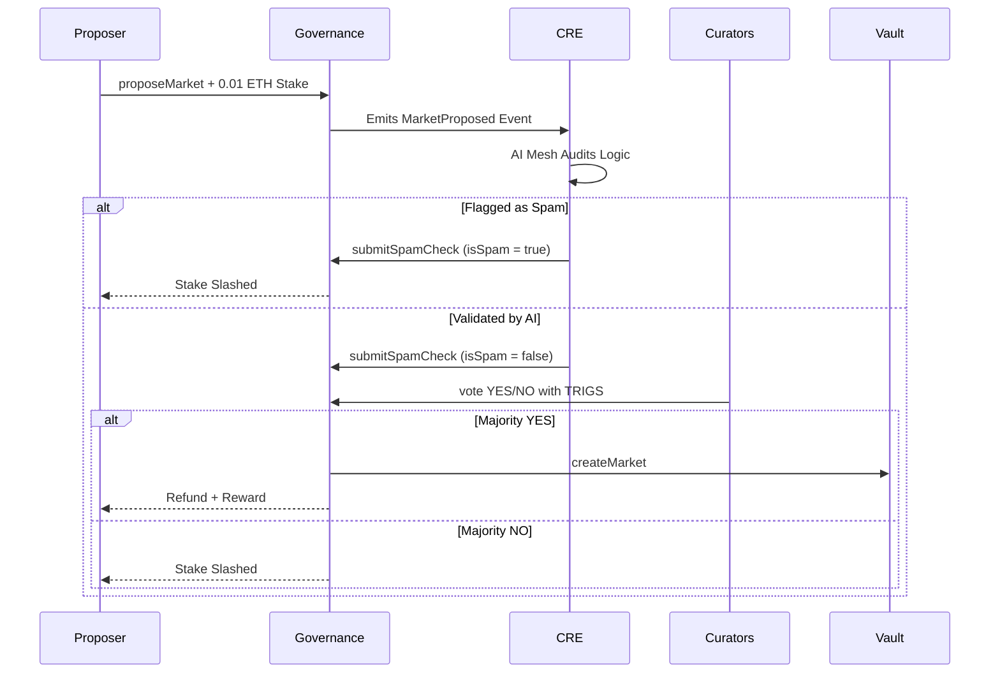

# Trigslink: AI-Augmented Decentralized Prediction Markets

**Live Application:** **[app.trigs.link](https://app.trigs.link)**
**Frontend Repository:** **[github.com/Trigs-link/trigslink-frontend](https://github.com/Trigs-link/trigslink-frontend)**

Trigslink is a fully decentralized prediction market protocol powered by Chainlink's new Custom Runtime Environment (CRE) and a decentralized mesh of Large Language Models (LLMs).

Instead of waiting days or weeks for subjective human dispute periods to settle a market, Trigslink uses objective, verifiable AI consensus to curate proposals, block spam, and resolve bets in under 15 seconds. By scraping the live web and reaching a multi-model consensus entirely off-chain, we bring unprecedented speed and absolute truth to decentralized markets—without ever relying on centralized oracles.

## Table of Contents

* [Overview](#overview)
* [The AI Mesh (Gatekeeper & Truth Engine)](#the-ai-mesh-gatekeeper--truth-engine)
* [System Architecture (High-Level)](#system-architecture-high-level)
* [Contracts Deep-Dive](#contracts-deep-dive)
  * [TrigslinkGovernance.sol](#trigslinkgovernancesol)
  * [TrigslinkVault.sol](#trigslinkvaultsol)
  * [TrigsToken.sol](#trigstokensol)
* [Chainlink Integrations](#chainlink-integrations)
  * [Custom Runtime Environment (CRE)](#custom-runtime-environment-cre)
  * [CCIP (Future Roadmap)](#ccip-future-roadmap)
* [Transaction Flows](#transaction-flows)
  * [1. Market Proposal & Curation Flow](#1-market-proposal--curation-flow)
  * [2. Betting & Settlement Flow](#2-betting--settlement-flow)
* [Testnet Deployments](#testnet-deployments)
* [Challenges Faced & Solutions](#challenges-faced--solutions)
* [Future Developments](#future-developments)
* [About the Developer](#about-the-developer)

---

## Overview

**Problem Statement:** "I want to trade on the outcome of future events, but existing prediction markets are flooded with spam proposals, ambiguous rules, and take days or weeks to resolve via human voting disputes."

**Solution:** Trigslink abstracts ALL of that away. By layering the [Chainlink Custom Runtime Environment (CRE)](https://docs.chain.link/chainlink-functions) over our smart contracts, we automate both the **curation** and **resolution** of markets using a decentralized mesh of LLMs.

Users stake ETH to propose markets. The AI Mesh immediately audits the proposal for logical consistency and verifiable data sources. If it passes, the community votes it in. Once the event concludes, the CRE scrapes the live internet, queries the LLM mesh, and resolves the market on-chain instantly.

---

## The AI Mesh (Gatekeeper & Truth Engine)

Trigslink does not rely on a single point of failure for its intelligence. We utilize a **Multi-Model Consensus Mesh** operating inside the Chainlink CRE sandbox.

* **Gemini 2.5 Flash:** Acts as the lead logic engine, checking if the question is "future-facing" and fetching live data to resolve outcomes.
* **Llama-3 70B (via Groq):** Acts as the high-speed timekeeper and cross-referencer.
* **Mistral (via OpenRouter):** Acts as the objectivity auditor to ensure proposal rules are not biased.

For a market to pass curation, or for an outcome to be resolved, Trigslink requires a strict **2/3 Majority Consensus** from these models.

---

## System Architecture (High-Level)

The Trigslink system consists of a deeply integrated network of smart contracts deployed on the Sepolia Testnet, interacting continuously with off-chain Chainlink infrastructure.

---

## Contracts Deep-Dive

### TrigslinkGovernance.sol

The curation hub. It tracks system-wide state for new proposals before they are allowed into the trading vault.

* `proposeMarket()`: Users must stake a `proposalStakeRequired` (in ETH) to suggest a market. This deters bad actors.
* `submitSpamCheck()`: A restricted endpoint exclusively called by the CRE Gatekeeper node to write the AI's spam verdict (`isSpam`) on-chain.
* `vote()`: Token holders use `$TRIGS` to vote YES or NO on the proposal.
* `executeProposal()`: If the market clears the AI check and community vote, it is pushed to the Vault. The proposer is refunded their stake *plus* a `successfulMarketReward`. If it is flagged as spam or voted down, the proposer's stake is slashed to the treasury.

### TrigslinkVault.sol

Manages the liquidity, betting, and resolution of live prediction markets.

* `createMarket()`: Restricted to the Governance contract. Initializes the pools.
* `placeBet()`: Allows users to bet ETH on Outcome 1 (Yes) or Outcome 2 (No) before the `endTime`.
* `requestSettlement()`: A public permissionless function that emits the `SettlementRequested` event, waking up the CRE Truth Engine.
* `onReport()`: The Chainlink DON delivers the final, AI-verified outcome here, officially resolving the market.
* `claimWinnings()`: Calculates proportional payouts for the winners based on the opposing pool's liquidity.

### TrigsToken.sol

An ERC-20 token (`$TRIGS`) that dictates voting weight. A public `mintTestTokens()` function is available for testers to freely participate in market curation.

---

## Chainlink Integrations

Trigslink leverages the bleeding edge of Chainlink's decentralized infrastructure to bridge on-chain markets with off-chain computation.

### Custom Runtime Environment (CRE)

Trigslink utilizes the **Chainlink CRE (v1.3.0 WASM Sandbox)** as the core engine, completely replacing legacy Automation and Functions patterns.

* **Log Triggers:** The CRE uses `evmClient.logTrigger` to natively listen for contract events, ensuring instant off-chain activation.
* **Decentralized Secrets:** We use `runtime.getSecret()` to securely manage API keys for Gemini, Groq, and OpenRouter across the DON.
* **HTTP Requests:** The CRE `HTTPClient` allows us to proxy requests through `r.jina.ai` to scrape live webpage content (the market's `dataSource`) and feed it directly into the LLMs.

### CCIP (Future Roadmap)

We have drafted `TrigslinkCrossChain.sol` to utilize [Chainlink CCIP (Cross-Chain Interoperability Protocol)](https://docs.chain.link/ccip) for unified cross-chain liquidity. In the future, users will be able to place bets from Base, Arbitrum, or Optimism, seamlessly routing their stablecoins to the parent Vault on Ethereum.

---

## Transaction Flows

### 1. Market Proposal & Curation Flow

### 2. Betting & Settlement Flow

1. **Betting:** Users call `placeBet(marketId, outcome)` with ETH.
2. **Market Ends:** The `endTime` passes.
3. **Trigger Settlement:** Anyone calls `requestSettlement()`.
4. **Truth Engine Analysis:** The CRE scrapes the web data source, and asks the AI Mesh to resolve the outcome based *only* on the provided evidence.
5. **Resolution:** The Chainlink DON calls `Vault.onReport()` with the final outcome.
6. **Payout:** Winners call `claimWinnings()` to withdraw their ETH.

---

## Testnet Deployments

Trigslink is currently deployed on the **Ethereum Sepolia Testnet**.

* **TrigslinkGovernance V3:** [`0xA3c6E2b06B3c511d52e7682Ba0Aec234F2BA692a`](https://sepolia.etherscan.io/address/0xA3c6E2b06B3c511d52e7682Ba0Aec234F2BA692a)
* **TrigslinkVault V3:** [`0xb989aaB780ae15E3820f8d97aE84D1bBB91914D2`](https://sepolia.etherscan.io/address/0xb989aaB780ae15E3820f8d97aE84D1bBB91914D2)
* **TrigsToken ($TRIGS):** [`0xc463bB636C67642870e2e82ebAdbd29e2C10eAFa`](https://sepolia.etherscan.io/address/0xc463bB636C67642870e2e82ebAdbd29e2C10eAFa)

---

## Challenges Faced & Solutions

Building an autonomous AI oracle required navigating significant technical hurdles, particularly with early-access infrastructure.

### CRE v1.3.0 WASM Memory Traps

During the integration of the Chainlink CRE simulator, I repeatedly encountered a critical `wasm trap: unreachable instruction executed` error. This happened during the subscription phase when the WASM host tried to map EVM event filters.

**Solution:** Standard JavaScript libraries handle `0x` prefixes gracefully, but the underlying Go-to-WASM converter in CRE v1.3.0 requires raw hex for the `hexToBase64` bridge. Passing `0x` created an invalid byte-length, causing memory misalignment. I engineered a sanitization helper (`hexToBase64(hex.replace(/^0x/, ""))`) to strip prefixes, which stabilized the entire pipeline.

### LLM Hallucinations & Determinism

Relying on a single AI model to resolve financial markets is inherently risky due to non-deterministic outputs.

**Solution:** I built the "Consensus Aggregation Mesh." Instead of one prompt, the CRE workflow simultaneously queries Gemini 2.5 Flash, Llama-3 70B, and Mistral. The workflow requires a strict 2/3 majority condition. This multi-model approach effectively filters out individual model hallucinations.

### Secure Web Scraping inside a Sandbox

The AI needed to read live webpages to resolve markets, but standard web-scraping libraries (like Puppeteer) cannot run inside the lightweight CRE WASM sandbox.

**Solution:** I utilized the `HTTPClient` to proxy URLs through `r.jina.ai`. This converted complex HTML pages into clean, LLM-readable markdown on the fly, allowing the AI to ingest vast amounts of real-time web context with a single, lightweight HTTP GET request.

---

## Future Developments

* **CCIP Cross-Chain Betting:** Integrating `TrigslinkCrossChain.sol` to allow liquidity deposits from Layer-2s directly into the Sepolia parent vault.
* **Automated Market Making (AMM):** Transitioning from a parimutuel pool model to an AMM (like a CPMM) to allow users to trade shares dynamically before the market resolves.
* **Yield-Bearing Deposits:** Routing the ETH locked in the Vault into Aave or Compound to generate yield for bettors while they wait for the market to resolve.

---

## About the Developer

Built with a focus on high-level system design and robust Web3 integrations.

* **Maintainer:** Aakash Jaiswal
* **Telegram:** [@jaiswalraj03014](https://t.me/jaiswalraj03014)
* **Email:** jaiswalraj03014@gmail.com
